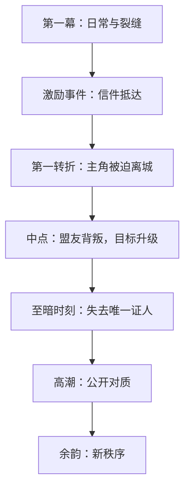
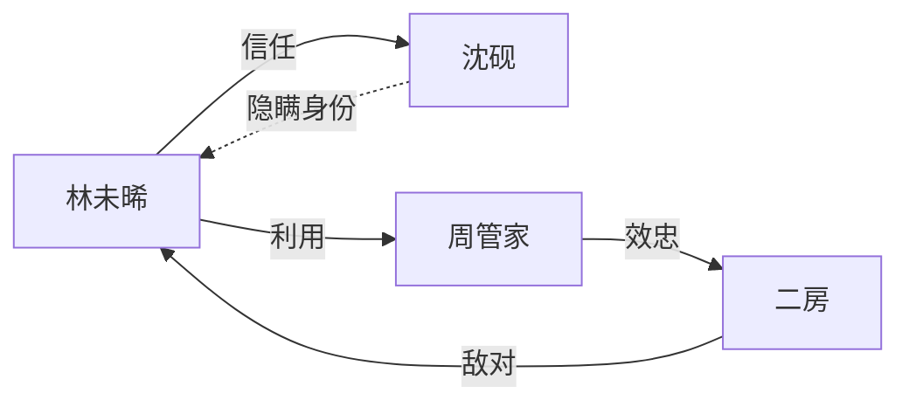
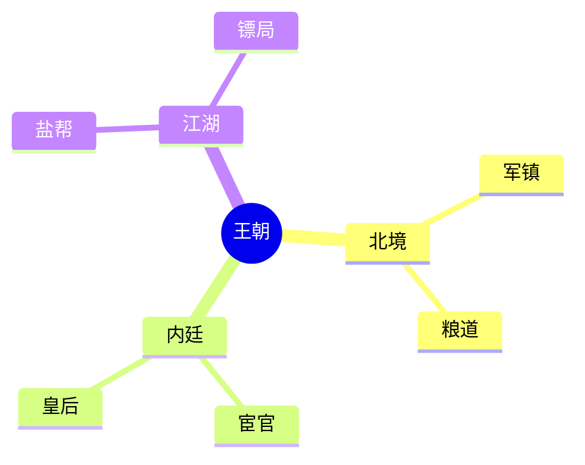
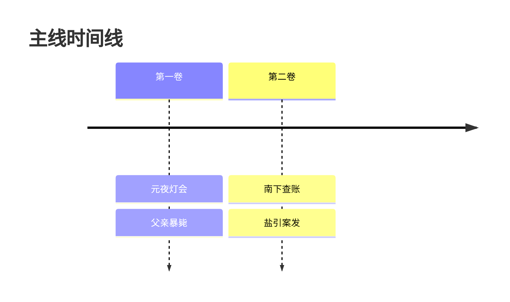

# 小说思维导图（Mind Map）

图是**决策工具**，不是装饰：每张图都要能回答一个具体问题（谁和谁对立？信息在哪一章释放？）。

## 先读

`story/outline/` → `story/characters/` → `story/world/` → `story/timeline.md`，从既有设定出图，不要凭想象补人物。

## 四类图

### 1. 故事结构图（flowchart）

### 2. 人物关系图（graph）

- 实线 = 明面关系，虚线 = 隐藏关系，箭头方向 = 谁对谁有意图。
- 每条边写**动词**（保护、利用、嫉妒、亏欠），不要只写“朋友”。

### 3. 势力 / 世界观图（mindmap）

### 4. 时间线（timeline）

## Mermaid 语法纪律（重要）

- 节点 id 用 ASCII 字母数字（`A`、`B1`），显示文字放进引号：`A["林未晞（主角）"]`。
- 中文括号、冒号、斜杠、逗号一律放进引号内，避免解析失败。
- `mindmap` 用缩进表达层级（每层 2 空格），节点内不要出现未转义的 `()`、`[]`、`{}`；根节点用 `root((文字))`。
- `timeline` 每行格式 `时间 : 事件 : 事件`，冒号分隔，事件里不要再出现裸冒号。
- 单图节点 ≤ 25 个；超了按“卷/势力/阵营”拆成多张图。
- id 必须唯一；箭头方向与因果方向一致（谁导致谁，而不是谁挨着谁）。

## 工作流

1. 先说明这张图要回答的问题，再画。
2. 出图，保存为 `story/mindmaps/<主题>.md`，文件开头写一句用途。
3. 图后写 **3 行读图结论**：结构上的问题、可以删掉的线、下一章该补的线。
4. 图与文字设定冲突时，以 `story/` 下的文字设定为准，并提示用户同步。

## 校验

- 引号成对、每行节点都有 id、没有空节点。
- 用 ASCII 缩进（空格，不用 Tab）。
- 无法确认渲染效果时，在图下方附一份纯文本缩进版作为兜底。

## 反模式

- 一张图塞进全部人物和全部事件，结果谁也看不清。
- 用图代替大纲：图只表达关系与结构，不写剧情细节。
- 边没有动词、方向随便画。
